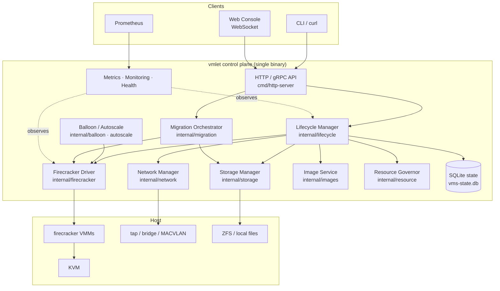
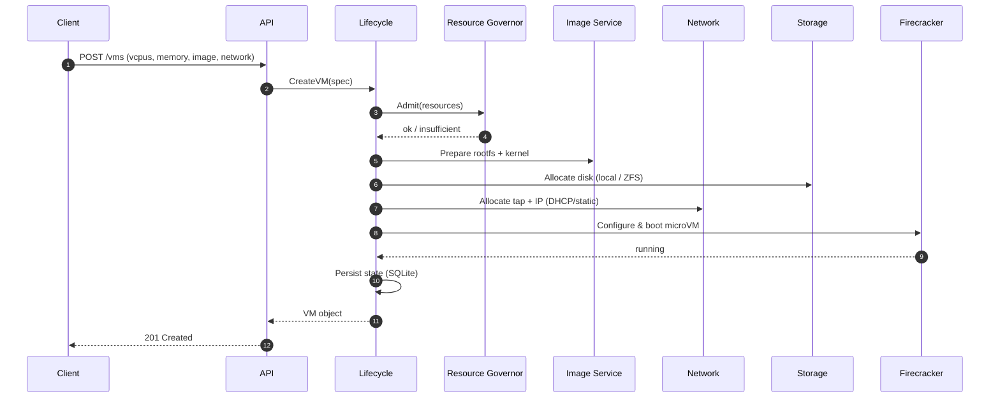
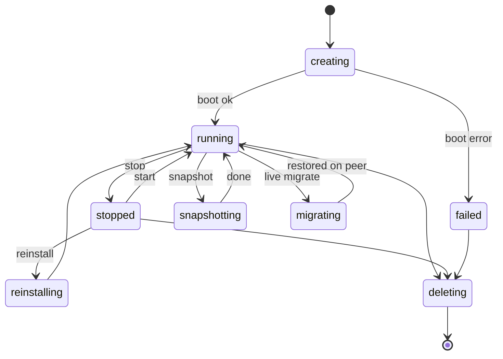

<div align="center">

# vmlet

**A self-hosted microVM platform built on [Firecracker](https://firecracker-microvm.github.io/).**

Spin up lightweight, secure Linux microVMs in milliseconds — with a REST API,
a web console, snapshots, live migration, autoscaling, and smart memory ballooning.

[](LICENSE)
[](go.mod)
[](https://firecracker-microvm.github.io/)
[](CONTRIBUTING.md)

[Quick Start](#-quick-start) ·
[Architecture](#-architecture) ·
[API](#-rest-api) ·
[Configuration](#-configuration) ·
[Docs](docs/) ·
[Contributing](CONTRIBUTING.md)

</div>

---

## What is vmlet?

`vmlet` is a single-binary control plane that turns a Linux host with KVM into a
microVM cloud. It wraps Firecracker's jailer-less API with the operational pieces
you actually need to run VMs for real users: networking, storage, images,
consoles, snapshots, migration, and resource governance.

It is designed to be **self-hosted and hackable** — no external database, no
message broker, no cloud account. State lives in a local SQLite file; metrics are
exposed in Prometheus format; everything is configurable through flags, env
vars, or a JSON file.

### Highlights

- ⚡ **Millisecond boot** — Firecracker microVMs with a minimal device model.
- 🌐 **REST API + web console** — create, start, stop, snapshot, and migrate VMs
  over HTTP; attach to a serial console in the browser over WebSocket.
- 🧠 **Smart memory ballooning** — reclaim idle guest memory and hand it back
  under pressure, with host-level safety thresholds.
- 📈 **Autoscaling** — per-VM CPU/memory policies evaluated on an interval.
- 💾 **Pluggable storage** — local files or ZFS datasets, with snapshots,
  clones, and rollback.
- 🔀 **Live & cold migration** — move a running VM between hosts by streaming
  disk + memory + device state, or export/import offline bundles.
- 🖼️ **Multi-distro image builder** — reproducible rootfs images for Ubuntu,
  Debian, Fedora, AlmaLinux, Alpine, and Arch via Docker.
- 🔒 **Network isolation** — per-VM tap devices, DHCP or static addressing,
  MACVLAN, IPv6, anti-spoofing, and bandwidth shaping.
- 📊 **Observability** — Prometheus `/metrics`, health endpoints, host resource
  stats, and per-VM traffic/memory accounting.

---

## 🏛 Architecture

`vmlet` is layered: an HTTP/gRPC surface delegates to a lifecycle manager, which
coordinates the Firecracker driver and the network, storage, image, and resource
subsystems. Cross-cutting concerns (metrics, monitoring, health) observe the
whole stack.



### Request lifecycle

A `POST /vms` call flows through validation, resource admission, image
preparation, network allocation, and finally Firecracker boot:



### VM state machine



---

## 🚀 Quick Start

### Prerequisites

- Linux host with **KVM** enabled (`/dev/kvm` present, nested virt if in a VM).
- **Go 1.22+** to build.
- A **Firecracker** binary on `PATH` (or set `MICROVM_FIRECRACKER_BIN`).
- A **kernel image** and a **rootfs image** (see [Building images](#-building-images)).
- Root (or equivalent capabilities) to manage tap devices, bridges, and cgroups.

> ⚠️ `vmlet` manipulates host networking and launches VMMs. Run it on a host you
> control, ideally behind a firewall. See [Security](#-security-notes).

### Build & run

```bash
git clone https://github.com/haioco/vmlet.git
cd vmlet

# Build the HTTP control plane
go build -o vmlet-http ./cmd/http-server

# Run with a dedicated bridge (defaults shown)
sudo ./vmlet-http \
  -network-bridge vmlet0 \
  -network-ip 10.130.146.1 \
  -network-cidr 10.130.146.0/24
```

The server listens on **:8080** by default (override with `PORT`). State is
written to `./work/vms-state.db` (override with `MICROVM_WORK_DIR`).

### Create your first VM

```bash
# List available images
curl http://localhost:8080/images

# Pull an image (builds/downloads the rootfs)
curl -X POST http://localhost:8080/images/ubuntu-24.04/download

# Boot a microVM
curl -X POST http://localhost:8080/vms \
  -H 'Content-Type: application/json' \
  -d '{
    "vcpus": 2,
    "memory_mb": 1024,
    "image_id": "ubuntu-24.04",
    "network": { "assignment_method": "dhcp", "enable_ssh": true },
    "cloudinit": { "username": "ubuntu", "password": "change-me" }
  }'

# Inspect it
curl http://localhost:8080/vms
curl http://localhost:8080/vms/<id>/stats
```

Open the web console by requesting a token and visiting the returned URL:

```bash
curl -X POST http://localhost:8080/vms/<id>/console/token
# -> { "url": "http://<host>:8080/console/<token>" }
```

---

## 🖼 Building images

Reproducible rootfs images are built from the Dockerfiles in [`dockerfiles/`](dockerfiles/).
Each produces a bootable ext4 rootfs with cloud-init and a vsock guest agent.

```bash
# Build all base images (requires Docker)
./build-images-docker.sh

# Or build a single distro
docker build -f dockerfiles/Dockerfile.ubuntu-24.04 -t vmlet/ubuntu-24.04 .
```

Supported families: **Ubuntu** (22.04 / 24.04 / 26.04), **Debian** (10–13),
**Fedora** (38–45), **AlmaLinux** (8 / 9 / 10), **Alpine** (3.18 / 3.24), and
**Arch Linux**. See [`docs/BOOTABLE_IMAGES_SETUP.md`](docs/BOOTABLE_IMAGES_SETUP.md).

---

## 🔌 REST API

All endpoints are served under the root path. A representative subset:

| Area | Method & Path | Purpose |
|------|---------------|---------|
| **VMs** | `POST /vms` · `GET /vms` | Create / list VMs |
| | `GET /vms/{id}` · `DELETE /vms/{id}` | Get / delete a VM |
| | `POST /vms/{id}/start` · `/stop` | Power control |
| | `POST /vms/{id}/reinstall` · `/password` | Rebuild / reset credentials |
| | `PUT /vms/{id}/resources` · `/bandwidth` | Live resource & shaping updates |
| | `GET /vms/{id}/stats` · `/traffic` · `/memory` | Usage accounting |
| **Console** | `POST /vms/{id}/console/token` | Issue a web-console token |
| | `GET /console/{token}` · `/console/{token}/ws` | Console page / WebSocket |
| | `GET /vms/{id}/ssh` | SSH access info |
| **Snapshots** | `POST /vms/{id}/snapshots` · `GET …` | Create / list snapshots |
| | `POST /vms/{id}/snapshots/{snap}` | Rollback |
| | `POST /vms/{id}/clone` | Clone a VM |
| **Migration** | `POST /vms/{id}/migrate` | Live-migrate to a peer |
| | `POST /vms/{id}/export` · `POST /vms/import` | Cold export / import |
| | `GET /migration/info` | Node migration capabilities |
| **Images** | `GET /images` · `GET /images/{id}` | Catalog |
| | `POST /images/{id}/download` | Fetch / build an image |
| **Resources** | `GET /resources/host` · `/resources/availability` | Host capacity |
| **Autoscale** | `PUT /vms/{id}/autoscale` · `GET …` | Per-VM policy |
| **Admin** | `POST /admin/cleanup-orphaned` | Reap orphaned units |
| | `GET/PUT /admin/quotas/{customer}` | Per-tenant quotas |
| **Observability** | `GET /health` · `/health/kernel` | Liveness / kernel check |
| | `GET /metrics` | Prometheus exposition |

Full reference: [`docs/API_DOCUMENTATION.md`](docs/API_DOCUMENTATION.md).

---

## ⚙ Configuration

Configuration resolves in this order: **flags → environment variables → JSON
config file → defaults**.

### Common flags (`cmd/http-server`)

| Flag | Env | Default | Description |
|------|-----|---------|-------------|
| `-network-bridge` | `MICROVM_NETWORK_BRIDGE` | `lxdbr0` | Bridge to attach taps to |
| `-network-ip` | `MICROVM_NETWORK_IP` | `10.130.146.1` | Bridge gateway IP |
| `-network-cidr` | `MICROVM_NETWORK_CIDR` | `10.130.146.0/24` | VM subnet |
| `-disable-dhcp` | `MICROVM_DISABLE_DHCP` | `true` | Use external dnsmasq instead of built-in DHCP |
| `-manage-nat` | `MICROVM_MANAGE_NAT` | `false` | Let vmlet manage NAT rules |
| `-hosts-file-dir` | `MICROVM_HOSTS_DIR` | LXD dnsmasq dir | Where to write DHCP host entries |
| `-config` | — | — | Path to a JSON config file |
| — | `PORT` | `8080` | HTTP listen port |

### Selected environment variables

| Variable | Purpose |
|----------|---------|
| `MICROVM_NETWORK_BACKEND` | Network backend: `bridge` (default) or `ovn` (not yet implemented, roadmap 1.2); `noop` for tests/external networking |
| `MICROVM_WORK_DIR` | State + runtime directory (default `./work`) |
| `MICROVM_FIRECRACKER_BIN` | Path to the Firecracker binary |
| `MICROVM_KERNEL_PATH` | Default kernel image |
| `MICROVM_IMAGES_DIR` | Rootfs image store |
| `MICROVM_USE_ZFS` / `MICROVM_ZFS_POOL` / `MICROVM_ZFS_DATASET` | Enable & locate ZFS storage |
| `MICROVM_AUTO_BALLOON` | Enable smart memory ballooning |
| `MICROVM_BALLOON_HOST_LOW_MB` / `MICROVM_BALLOON_SAFETY_MB` | Balloon safety thresholds |
| `MICROVM_AUTOSCALE_INTERVAL_SEC` | Autoscale evaluation interval |
| `MICROVM_MACVLAN_PARENT` | Parent interface for MACVLAN mode |
| `MICROVM_MAX_STORAGE_MB` | Per-VM disk cap |
| `MICROVM_CREATE_WORKERS` / `MICROVM_CREATE_DELAY_MS` | Creation queue concurrency |

A full example config lives at [`configs/local-dev.json`](configs/local-dev.json);
production and test variants are alongside it.

### Running as a service

```bash
sudo ./scripts/deploy-production.sh
```

This installs a `vmlet.service` systemd unit. See
[`docs/PRODUCTION_DEPLOYMENT.md`](docs/PRODUCTION_DEPLOYMENT.md).

---

## 📁 Repository layout

```
vmlet/
├── cmd/
│   ├── http-server/      # REST control plane (main entry point)
│   ├── hybrid-server/    # HTTP + gRPC hybrid entry point
│   └── main.go           # CLI / library-style entry point
├── internal/
│   ├── api/              # gRPC service definitions & handlers
│   ├── firecracker/      # VMM driver: boot, config, devices, SSH
│   ├── lifecycle/        # VM state machine & orchestration
│   ├── network/          # bridges, DHCP, reservations, SSH forwarding, pluggable backends
│   ├── ovn/              # OVN Northbound integration (logical topology reconcile)
│   ├── ovs/              # Open vSwitch datapath wiring (br-int, TAP ports, iface-id)
│   ├── storage/          # local / ZFS / SQLite backends
│   ├── images/           # rootfs catalog & preparation
│   ├── balloon/          # memory reclaim / give-back
│   ├── autoscale/        # per-VM scaling policies
│   ├── migration/        # live & cold migration, export/import
│   ├── cloudinit/        # guest initialization payloads
│   ├── resource/         # admission control & quotas
│   ├── metrics/          # Prometheus exposition
│   ├── monitoring/       # alerting & structured logging
│   ├── health/           # liveness / readiness probes
│   ├── models/           # shared domain types
│   ├── config/           # config loading & validation
│   ├── validation/       # request/spec validation
│   ├── pricing/          # resource cost model (optional)
│   ├── performance/      # tuning helpers
│   ├── production/       # production hardening helpers
│   └── lxd/              # LXD interop / import helpers
├── api/microvm.proto     # gRPC contract
├── pkg/types/            # shared TypeScript types (frontend contract)
├── dockerfiles/          # multi-distro rootfs builders + vsock agent
├── configs/              # example JSON configs
├── docs/                 # engineering & operations guides
├── scripts/              # deploy, test, tuning, migration helpers
└── demo/                 # runnable examples
```

---

## 🧪 Development

```bash
go build ./...          # build everything
go vet ./...            # static analysis
go test ./...           # unit tests (see note below)
```

> **Note:** a few legacy test files (`internal/firecracker`, `internal/lifecycle`,
> parts of `internal/monitoring` and `internal/resource`) reference older internal
> APIs and do not currently compile/pass. They are pre-existing and tracked for
> cleanup — see [CONTRIBUTING.md](CONTRIBUTING.md). The production packages
> (`cmd/http-server`, `cloudinit`, `images`, `migration`, `network`, `performance`,
> `pricing`, `validation`) build and test cleanly.

Run the storage demo:

```bash
go run ./demo/storage-demo
```

---

## 🗺 Roadmap

vmlet is heading toward a full self-hosted microVM cloud:

1. **OVN primary networking** (`v0.2.0`) — logical overlay, native DHCP/DNS, ACL security groups
2. **Multi-node cluster** (`v0.3.0`) — shared state, scheduler, one API, drain/maintenance
3. **Auto live migration / DRS** (`v0.4.0`) — VMware-DRS-style continuous load balancing
4. **v1.0.0 GA** — all three pillars stable, public API frozen

Details: [ROADMAP.md](ROADMAP.md) · tracking: [GitHub project board](https://github.com/haioco/vmlet/projects) ·
versioning policy: [docs/VERSIONING.md](docs/VERSIONING.md)

---

## 📚 Documentation

Engineering and operations guides live in [`docs/`](docs/):

| Guide | Topic |
|-------|-------|
| [ARCHITECTURE.md](docs/ARCHITECTURE.md) | Internal design & engineering deep-dive |
| [VERSIONING.md](docs/VERSIONING.md) | SemVer policy, releases & branching model |
| [API_DOCUMENTATION.md](docs/API_DOCUMENTATION.md) | Full REST reference |
| [DEPLOYMENT_GUIDE.md](docs/DEPLOYMENT_GUIDE.md) · [PRODUCTION_DEPLOYMENT.md](docs/PRODUCTION_DEPLOYMENT.md) | Deploy & harden |
| [NETWORKING_CONFIGURATION_GUIDE.md](docs/NETWORKING_CONFIGURATION_GUIDE.md) | Bridges, DHCP, MACVLAN, IPv6 |
| [OVN.md](docs/OVN.md) | OVN backend: architecture, setup, tuning, troubleshooting |
| [STORAGE_CONFIGURATION_GUIDE.md](docs/STORAGE_CONFIGURATION_GUIDE.md) | Local / ZFS / snapshots |
| [VM_MIGRATION_GUIDE.md](docs/VM_MIGRATION_GUIDE.md) | Live & cold migration |
| [MONITORING_GUIDE.md](docs/MONITORING_GUIDE.md) | Metrics & alerting |
| [BOOTABLE_IMAGES_SETUP.md](docs/BOOTABLE_IMAGES_SETUP.md) · [TROUBLESHOOTING](docs/BOOTABLE_IMAGES_TROUBLESHOOTING.md) | Image building |
| [OPERATIONAL_PROCEDURES.md](docs/OPERATIONAL_PROCEDURES.md) · [TROUBLESHOOTING_GUIDE.md](docs/TROUBLESHOOTING_GUIDE.md) | Day-2 ops |
| [LOCAL_TESTING.md](docs/LOCAL_TESTING.md) | Local dev & tests |

---

## 🔐 Security notes

- `vmlet` requires elevated privileges to manage KVM, tap devices, and cgroups.
  Run it on a dedicated, firewalled host.
- The REST API has **no built-in authentication** in the open-source build.
  Front it with a reverse proxy / mTLS / network policy before exposing it.
- Change all default credentials and the migration token
  (`CHANGE_ME_MIGRATION_TOKEN`) before production use.
- Anti-spoofing and per-VM bandwidth shaping are available via `MICROVM_ANTISPOOF_*`
  and bandwidth settings — enable them for multi-tenant hosts.

---

## 🏢 Maintainer

`vmlet` is developed and maintained by **[HaioCloud](https://haio.ir)** — the
first Iranian cloud provider, offering hourly, pay-as-you-go cloud services in
Iran since **2016**. vmlet is the microVM engine battle-tested in production
behind HaioCloud's cloud server platform, now open-sourced for everyone.

- 🌐 Website: [haio.ir](https://haio.ir)
- 📧 Contact: [info@haio.ir](mailto:info@haio.ir)

## 🤝 Contributing

Contributions are welcome! Please read [CONTRIBUTING.md](CONTRIBUTING.md) for
the development workflow, coding standards, and how to submit changes.

## 📄 License

`vmlet` is released under the **MIT License** — see [LICENSE](LICENSE).
