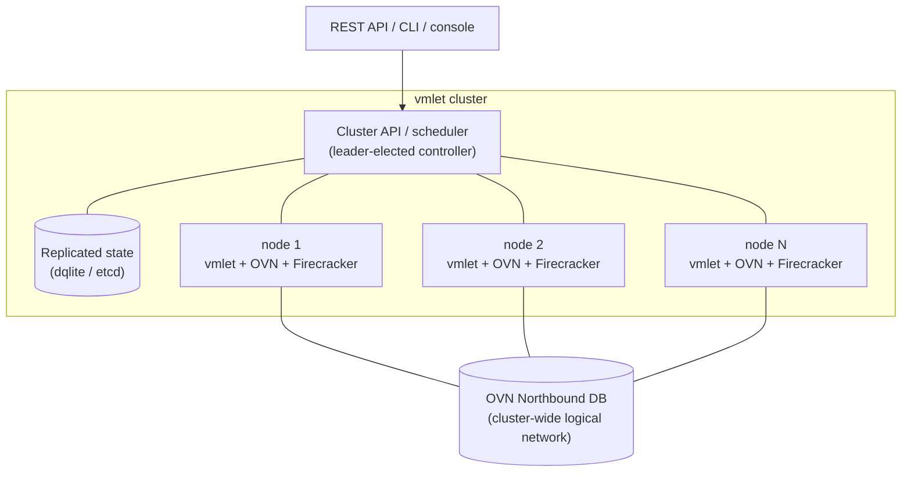
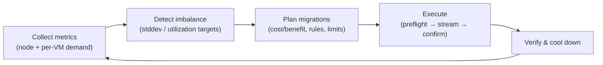

# vmlet Roadmap

This roadmap describes the evolution of vmlet from a **single-node Firecracker
microVM host** into a **self-hosted, OVN-networked microVM cloud with
VMware-DRS-style automatic load balancing**.

The three pillars, in dependency order:

1. **OVN as the primary VM network** — a logical overlay that is node-independent.
2. **Multi-node cluster** — membership, shared state, scheduling, one API.
3. **Auto live migration (DRS)** — continuous rebalancing of VMs across nodes
   using the existing live-migration pipeline.

OVN comes first on purpose: with a logical overlay network, a VM keeps its IP,
MAC, security groups and connectivity when it moves between hosts — which is
the hard prerequisite for both clustering and transparent live migration.

**Versioning:** the three phases ship as `v0.2.0` → `v0.3.0` → `v0.4.0`;
**v1.0.0 (GA)** is tagged when all three are generally available and the
public API is frozen. See [docs/VERSIONING.md](docs/VERSIONING.md) for the
full policy (SemVer, trunk-based development, tags — not long-lived version
branches).

> **Tracking:** every item below is a GitHub issue on the
> [vmlet Roadmap project board](https://github.com/orgs/haioco/projects) —
> see the project for live status, assignees and discussion.

---

## Where we are today (v0.1.0)

| Area | Current implementation |
|---|---|
| Networking | Linux bridge + TAP (`lxdbr0`), dnsmasq DHCP via per-VM hosts files, optional MACVLAN, IPv6, ebtables anti-spoof, `tc` bandwidth shaping |
| Compute | Firecracker microVMs, per-VM ops lock, creation queue workers |
| Memory | Smart balloon + per-VM vertical autoscaling, memory guarantees/profiles |
| Storage | Local file, ZFS (snapshots/clones/send-recv), NBD; SQLite state per node |
| Migration | Cold export/import + live migration over HTTP peer streams (disk / memory / vmstate), preflight checks, abort/confirm |
| Observability | Prometheus `/metrics`, health endpoints, structured logs |
| Scope | **One node.** No cluster membership, no placement decisions, no cross-node automation |

The live-migration machinery already works node-to-node; what is missing is
everything *around* it: a network that survives the move, a cluster that knows
its nodes, and a brain that decides when to move what.

---

## Phase 1 — OVN primary networking (milestone `v0.2.0`)

**Goal:** make [OVN](https://www.ovn.org/) (Open Virtual Network, the overlay
control plane of Open vSwitch) the default network backend for VMs, while
keeping the current bridge backend as a supported fallback.

### Why OVN

- **Logical switches/routers** decouple VM networking from any physical host.
- **Native DHCP/DNS** — replaces the dnsmasq hosts-file plumbing.
- **ACLs & port security** — replaces ebtables anti-spoof rules with
  declarative, per-port security groups.
- **Distributed routing & NAT** — east-west traffic never leaves the overlay;
  floating IPs / SNAT map cleanly onto the existing IPv4-addon model.
- **Geneve tunnels between hosts** — the same logical network spans every
  node, so a migrated VM keeps its IP and connections (Phase 2/3 prerequisite).

### Work items

| # | Item | Notes |
|---|---|---|
| 1.1 | **Network backend abstraction** | Extract a `network.Backend` interface from the current bridge/DHCP/anti-spoof code; `bridge` becomes one implementation. Selection via `MICROVM_NETWORK_BACKEND=bridge\|ovn` (default stays `bridge` until OVN is GA). |
| 1.2 | **OVN integration package** (`internal/ovn`) | Talk to the OVN Northbound DB via `libovsdb` (pure Go) with `ovn-nbctl` fallback. Idempotent reconcile loop: desired logical topology derived from SQLite VM state, applied transactionally. |
| 1.3 | **OVS datapath wiring** | `br-int` integration bridge; Firecracker TAP devices attached as OVS ports with `iface-id` = logical port name. Host setup script + systemd units (`ovn-controller`, `ovsdb-server`, `ovn-northd`). |
| 1.4 | **Logical switch per network / tenant** | One logical switch per VM network; logical router for inter-network + external traffic; provider/external bridge mapping for uplink. |
| 1.5 | **Native DHCP & DNS** | OVN `DHCP_Options` per subnet; static reservations keyed by MAC; replaces dnsmasq hosts files. Cloud-init static config path stays as fallback. |
| 1.6 | **Security groups via ACLs** | Port security (MAC/IP anti-spoof) + stateful ACLs per VM; API-compatible with existing anti-spoof toggles (`MICROVM_ANTISPOOF_*`). |
| 1.7 | **QoS via OVS** | Map existing bandwidth ingress/egress limits to OVS QoS queues/policing instead of `tc`. |
| 1.8 | **Floating IPs / distributed NAT** | DNAT/SNAT logical router policies backing the `/vms/{id}/ipv4` addon endpoints; gateway HA later. |
| 1.9 | **Migration & compatibility** | Bridge→OVN migration tool for existing VMs; mixed-mode operation during rollout; e2e tests (create/connect/migrate/snapshot with OVN). |
| 1.10 | **Docs & operator guide** | `docs/OVN.md`: architecture diagram, host prerequisites, tuning (MTU/Geneve), troubleshooting (`ovn-trace`, `ovs-ofctl`). |

**Exit criteria:** a VM created on the OVN backend gets DHCP, internet,
security groups, bandwidth limits and console parity with bridge mode; a VM
can be live-migrated to a second host **with its IP unchanged** (manual
migration, proving the overlay).

---

## Phase 2 — Multi-node cluster (milestone `v0.3.0`)

**Goal:** N vmlet hosts behave as one cloud: one API surface, shared state,
node-aware placement, and migrations that are cluster operations rather than
point-to-point hacks.

### Architecture sketch

### Work items

| # | Item | Notes |
|---|---|---|
| 2.1 | **Cluster membership & discovery** | `vmlet cluster init / join / leave`; static seed list first, gossip/heartbeat later. Node registry: capacity, allocatable, labels/taints, health. |
| 2.2 | **Replicated state store** | Move VM/cluster state from per-node SQLite to a replicated store (dqlite or etcd) behind the existing storage interface; per-node SQLite remains as a local cache/agent store. Migration path + backward compatibility for single-node installs. |
| 2.3 | **Node agent & controller split** | Factor `cmd/http-server` into a **controller** (API, scheduler, cluster state) and a **node agent** (Firecracker lifecycle, storage, OVN wiring). Single-node mode runs both in one process — no breaking change. |
| 2.4 | **Scheduler / placement** | Filter (fit? taints? storage backend? network?) + score (least-allocated, bin-pack, anti-affinity) placement for `POST /vms`; explicit `node` hint honored; quotas per cluster. |
| 2.5 | **Cluster API & auth** | `/cluster/nodes`, `/cluster/vms`, cluster-wide events; mTLS + token auth between nodes (replaces the shared `CHANGE_ME_MIGRATION_TOKEN`); RBAC groundwork. |
| 2.6 | **Cluster-aware migration** | Upgrade the peer-stream migration pipeline to a controller-orchestrated operation: preflight against *target node capacity*, OVN port binding move, storage transfer (ZFS send/recv or NBD), confirm/abort with cluster state updates. |
| 2.7 | **OVN multi-node rollout** | Centralized OVN NB/SB (RAFT) + `ovn-controller` on every node; Geneve tunnels; verification that VM IP/MAC/ACLs follow the VM across hosts. |
| 2.8 | **Node lifecycle ops** | Maintenance mode & drain (evacuate VMs via live migration), cordon, safe shutdown; orphan reconciliation across nodes. |
| 2.9 | **CLI & console** | `vmlet node ls / drain / uncordon`, cluster view in the web console (nodes, capacity heat-map, VM placement). |
| 2.10 | **HA foundations** | Controller leader election; state survives single-node loss; node-failure detection (VM restart/HA is Phase 3+). |
| 2.11 | **Docs & e2e** | `docs/CLUSTER.md`, 3-node test harness (containers/VMs), chaos basics (kill a node mid-migration). |

**Exit criteria:** 3-node cluster; create VM without choosing a node; drain a
node and watch its VMs live-migrate away with zero IP change; kill the leader
and the API stays up.

---

## Phase 3 — Auto live migration / DRS (milestone `v0.4.0`)

**Goal:** a continuous control loop that keeps the cluster balanced —
the open-source answer to VMware DRS — built on the Phase 2 scheduler and the
existing live-migration pipeline.

### Control loop

### Work items

| # | Item | Notes |
|---|---|---|
| 3.1 | **Demand model** | Per-node: CPU steal/load, memory pressure (balloon stats already exposed), storage I/O, network. Per-VM: actual demand vs reservation (from metrics + balloon). Expose as cluster metrics. |
| 3.2 | **Imbalance detection** | Configurable utilization targets + deviation threshold; DRS-style **aggressiveness levels 1–5** (conservative → aggressive); per-cluster and per-pool settings. |
| 3.3 | **Migration planner** | Simulate candidate moves, score by projected balance gain vs migration cost (memory size, dirty-page rate, storage delta); respect affinity/anti-affinity, per-VM opt-out (`drs=disabled`), maintenance constraints. |
| 3.4 | **Execution engine** | Rate limits (max concurrent migrations, per-node budget), cooldowns, convergence guard (skip VMs whose dirty-page rate won't converge), retry/abort with audit trail. Reuses Phase 2 cluster migration. |
| 3.5 | **Dry-run & observability** | `drs dry-run` recommendations API + CLI; every decision logged with before/after balance scores; Prometheus metrics (`vmlet_drs_migrations_total`, imbalance score). |
| 3.6 | **Rules & policies API** | VM↔VM affinity/anti-affinity, VM↔host rules, per-VM automation level (manual / partially automated / fully automated — mirroring DRS). |
| 3.7 | **Scheduled / predictive rebalancing** | Time-window policies (e.g. bin-pack at night for power saving), trend-based pre-emption of hotspots; pluggable scorer interface for future ML models. |
| 3.8 | **VM HA (stretch)** | On node failure: restart affected VMs on healthy nodes (storage permitting), fenced-node protection to avoid split-brain double-run. |
| 3.9 | **Docs & tuning guide** | `docs/DRS.md`: how the loop works, knobs, safe defaults, failure modes. |

**Exit criteria:** under uneven synthetic load, the cluster rebalances itself
within configured limits; dry-run matches executed behavior; no VM loses
network identity; every action is auditable and reversible.

---

## v1.0.0 — General Availability

v1.0.0 is not a separate development branch: it is the **tag** cut from `main`
once Phases 1–3 are all GA. Exit criteria (full list in
[docs/VERSIONING.md](docs/VERSIONING.md)):

- OVN default backend (bridge still supported); 3-node cluster e2e suite green
  (placement, drain, leader failover, mid-migration node loss).
- DRS rebalances within configured limits; dry-run parity; full audit trail.
- VMs keep IP/MAC/security groups across live migration.
- OpenAPI-documented, compatibility-tested REST API; auth on by default for
  cluster endpoints; tested upgrade path from v0.1 single-node installs.

From v1.0.0 onward the public API is frozen under SemVer: breaking changes
require a major version, deprecations ship at least one minor before removal.

---

## Beyond (ideas, unscheduled)

- **Shared / replicated storage classes** — Ceph RBD or ZFS-over-network targets
  so HA restart doesn't depend on local disks.
- **GPU / device passthrough** scheduling.
- **Kubernetes integration** — vmlet as a KubeVirt-style runtime or a
  Cluster-API infrastructure provider.
- **Web console v2** — cluster topology view, live migration progress, DRS
  recommendations UI.
- **Terraform / Pulumi providers** for vmlet clusters.
- **Multi-architecture** — ARM64 Firecracker hosts.

---

## How we work

- Each roadmap item is a GitHub issue labeled `phase-1/ovn`, `phase-2/cluster`
  or `phase-3/drs`, tracked on the **vmlet Roadmap** GitHub Project and grouped
  under milestones `v0.2.0`, `v0.3.0`, `v0.4.0`.
- Versions are **tags on `main`**, not long-lived branches (trunk-based
  development — see [docs/VERSIONING.md](docs/VERSIONING.md)). Phase work lands
  behind toggles and safe defaults; `v1.0.0` is the GA tag, not a "version 1
  branch".
- Phases are sequential in their *core* items, but independent items (docs,
  CLI, metrics) can proceed in parallel — contributors welcome on any issue.
- Design decisions land as short RFCs in `docs/rfcs/` before implementation.
- Nothing breaks single-node users: every phase keeps the one-process,
  one-host deployment working.

Maintained by [HaioCloud](https://haio.ir) — the first Iranian cloud provider,
offering hourly, pay-as-you-go cloud services in Iran since 2016.
