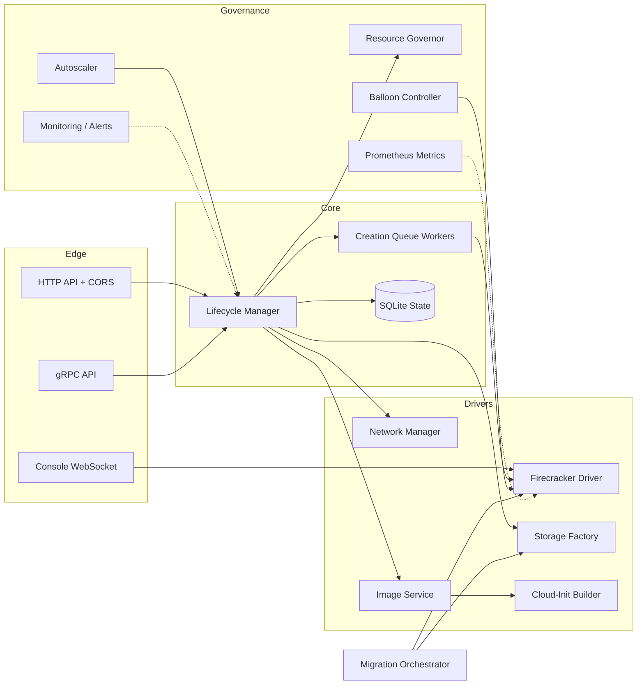
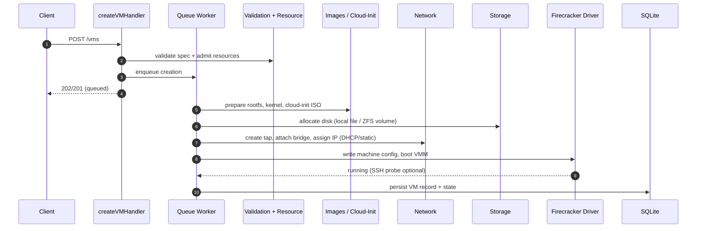
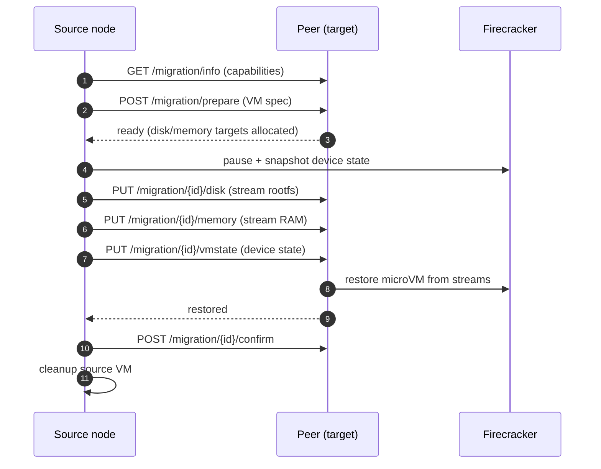

# vmlet Architecture

This document describes the internal design of vmlet: how the subsystems are
organized, how a request flows through the system, and the key engineering
decisions behind networking, storage, memory management, and migration.

For deployment and day-2 operations see the other guides in [`docs/`](.).

---

## 1. Design goals

| Goal | How it is achieved |
|------|--------------------|
| **Single-binary simplicity** | One Go binary (`cmd/http-server`) embeds the API, orchestration, and drivers. No external DB or broker. |
| **Fast, safe VMs** | Firecracker microVMs: minimal device model, KVM isolation, millisecond boot. |
| **Self-hosted state** | SQLite (`vms-state.db`) in the work directory holds VM records; the host filesystem/ZFS holds disks. |
| **Operability** | Prometheus `/metrics`, health probes, structured logs, admin cleanup endpoints. |
| **Hackability** | Layered `internal/` packages with clear boundaries; config via flags/env/JSON. |

---

## 2. Component overview



### Package responsibilities

| Package | Responsibility |
|---------|----------------|
| `cmd/http-server` | REST surface, routing, console tokens/WebSocket, creation queue, admin endpoints. The primary entry point. |
| `cmd/hybrid-server` | Combined HTTP + gRPC entry point. |
| `internal/api` | gRPC service implementation over the same core. |
| `internal/lifecycle` | VM state machine; coordinates create/start/stop/delete/reinstall across drivers. |
| `internal/firecracker` | The VMM driver: machine config, boot, drives, network interfaces, vsock, SSH probes, error recovery. Largest package. |
| `internal/network` | Bridge management, tap allocation, DHCP (dnsmasq hosts files), IP reservations, SSH port forwarding. |
| `internal/storage` | Storage abstraction (`interface.go`) with `file` (local), `zfs`, and `sqlite` (state) backends; selected via `factory.go`. |
| `internal/images` | Rootfs/kernel catalog, download/build, per-VM disk preparation. |
| `internal/cloudinit` | Generates cloud-init user-data/network-config for guest initialization. |
| `internal/balloon` | Smart memory balloon: reclaim idle guest memory, give back under pressure, host safety thresholds. |
| `internal/autoscale` | Per-VM scaling policies evaluated on `MICROVM_AUTOSCALE_INTERVAL_SEC`. |
| `internal/resource` | Admission control: host capacity checks, per-VM caps, quotas. |
| `internal/migration` | Live migration orchestrator, peer client, receiver, preflight checks, ZFS send/recv, cold export/import. |
| `internal/metrics` | Dependency-free Prometheus exposition (`/metrics`). |
| `internal/monitoring` | Alert rules, alert history, structured logging. |
| `internal/health` | Liveness/readiness and kernel availability checks. |
| `internal/models` | Shared domain types (VM spec, status, network, storage). |
| `internal/config` | JSON config loading + validation + defaults. |
| `internal/validation` | Request/spec validation helpers. |
| `internal/pricing` | Optional resource cost model (usage accounting). |
| `internal/performance` | Tuning helpers (host/guest performance knobs). |
| `internal/production` | Production hardening helpers. |
| `internal/lxd` | LXD interop / container-to-microVM import helpers. |

---

## 3. State & persistence

- **VM records** live in SQLite at `<work-dir>/vms-state.db`
  (`internal/storage/sqlite.go`). The work dir resolves as:
  `MICROVM_WORK_DIR` → legacy `./firecracker-work` (if present) → `./work`.
- **Disks** live either as local files (`internal/storage/file.go`) or as ZFS
  volumes/datasets (`internal/storage/zfs.go`) under `MICROVM_ZFS_POOL` /
  `MICROVM_ZFS_DATASET`.
- **Runtime artifacts** (sockets, console logs, firecracker logs, cloud-init
  ISOs) are kept under the work dir per VM.
- On startup the server reconciles persisted state with running VMMs and can
  reap orphaned systemd units via `POST /admin/cleanup-orphaned`.

---

## 4. VM creation flow

Creation is queued and processed by a worker pool
(`MICROVM_CREATE_WORKERS`, `MICROVM_CREATE_DELAY_MS`) so bursts don't overwhelm
the host. Mutating operations on a single VM are serialized via an in-flight
map (`vmOpsInFlight`) to prevent concurrent start/stop/snapshot races.



Failure at any step triggers cleanup of partially-created artifacts (tap
devices, disks, units) so the host doesn't leak resources.

---

## 5. Networking

`internal/network` supports several attachment modes:

- **Bridge + tap** (default): each VM gets a tap device attached to
  `-network-bridge`. Addressing is either:
  - **DHCP** via dnsmasq — vmlet writes per-VM host entries into
    `-hosts-file-dir` (MAC → IP), or
  - **Static** — cloud-init configures the guest directly.
- **MACVLAN** (`MICROVM_MACVLAN_PARENT`): VMs attach directly to a parent
  physical interface for L2 presence on the LAN.
- **IPv6** (`MICROVM_IPV6_*`): optional dual-stack addressing.
- **NAT** (`-manage-nat` / `MICROVM_MANAGE_NAT`): vmlet can install masquerade
  rules, or defer to the bridge's own NAT (e.g. LXD).
- **Anti-spoofing** (`MICROVM_ANTISPOOF_*`) and **bandwidth shaping**
  (`PUT /vms/{id}/bandwidth`, tc-based) enforce per-VM network policy.
- **SSH forwarding** (`internal/network/ssh_manager.go`) maps host ports to
  guest :22, surfaced by `GET /vms/{id}/ssh`.

---

## 6. Storage & snapshots

The storage factory picks a backend from config/env:

| Backend | Snapshots | Clones | Notes |
|---------|-----------|--------|-------|
| **local file** | file copy | file copy | Simple, portable; default. |
| **ZFS** | `zfs snapshot` | `zfs clone`/send | Instant, space-efficient; enables live migration via send/recv. |

- `POST /vms/{id}/snapshots` captures disk (and optionally memory) state.
- `POST /vms/{id}/snapshots/{snap}` rolls back.
- `POST /vms/{id}/clone` produces a new VM from a disk/snapshot.
- Per-VM disk caps are enforced via `MICROVM_MAX_STORAGE_MB` and the resource
  governor.

---

## 7. Memory management: balloon + autoscale

- **Smart balloon** (`internal/balloon`, enabled by `MICROVM_AUTO_BALLOON`)
  periodically inspects guest memory usage and inflates/deflates the virtio
  balloon to reclaim idle pages. Safety knobs:
  `MICROVM_BALLOON_HOST_LOW_MB`, `MICROVM_BALLOON_SAFETY_MB`,
  `MICROVM_BALLOON_MAX_PERCENT`, `MICROVM_BALLOON_CHECK_INTERVAL_MS`,
  `MICROVM_BALLOON_FAST_POLL_MS`, `MICROVM_BALLOON_ALWAYS_RECLAIM`.
- **Autoscale** (`internal/autoscale`) applies per-VM CPU/memory policies on
  `MICROVM_AUTOSCALE_INTERVAL_SEC`, calling the lifecycle manager to resize.
- **Memory guarantee** (`PUT /vms/{id}/memory/guarantee`) pins a minimum so
  ballooning never starves a workload; `GET /vms/{id}/memory/profile` reports
  usage history.

---

## 8. Migration

`internal/migration` implements both **live** and **cold** movement between
vmlet nodes.

### Live migration (running VM)



- **Preflight** (`preflight.go`) checks peer reachability, capacity, kernel and
  image compatibility before starting.
- Streams can be aborted (`/migration/{id}/abort`, `/vms/{id}/migration/abort`)
  with rollback on both sides.
- ZFS-backed disks use `zfs send/recv` (`zfs_ops.go`) for efficient transfer.

### Cold migration (offline)

- `POST /vms/{id}/export` produces a portable bundle (disk + config) listed
  under `GET /exports` and downloadable via `GET /exports/{name}`.
- `POST /vms/import` restores a bundle on another node.

Peer authentication uses a shared migration token — **change the
`CHANGE_ME_MIGRATION_TOKEN` default** before connecting real nodes.

---

## 9. Images & guest initialization

- Rootfs images are built from [`dockerfiles/`](../dockerfiles/) — each
  Dockerfile installs a distro, cloud-init, and a **vsock guest agent**
  (`vsock-agent-linux`) used for host↔guest commands (password reset, config
  sync, console repair).
- `internal/images` catalogs images and prepares per-VM disks;
  `internal/cloudinit` renders user-data (users, SSH keys, password) and
  network-config consumed at first boot.
- `POST /vms/{id}/reinstall` rebuilds the rootfs from the base image;
  `POST /vms/{id}/password` and `PUT /vms/{id}/ssh-keys` use the vsock agent to
  update credentials in a running guest.

---

## 10. Observability

- **Metrics** (`internal/metrics`): dependency-free Prometheus exposition at
  `GET /metrics` — VM counts, resource usage, creation queue depth, operation
  latencies.
- **Health**: `GET /health` (liveness) and `GET /health/kernel` (KVM/kernel
  availability).
- **Monitoring** (`internal/monitoring`): alert rules with history/stats and
  structured logging.
- **Accounting**: `GET /vms/{id}/stats`, `/traffic`, `/memory` expose per-VM
  usage for dashboards or chargeback.

---

## 11. Configuration precedence

```
flags  >  environment variables (MICROVM_*)  >  JSON config (-config)  >  defaults
```

`internal/config` loads and validates the JSON file (see
[`configs/local-dev.json`](../configs/local-dev.json)); `cmd/http-server`
overlays env/flags for the networking and runtime knobs. The HTTP port is
`cfg.Server.Port` (default **8080**) overridden by `PORT`.

---

## 12. Concurrency model

- **Creation queue**: bounded worker pool decouples API acceptance from the
  expensive boot path.
- **Per-VM operation lock**: `vmOpsInFlight` (guarded by a mutex) serializes
  mutating operations per VM ID.
- **Console tokens**: `consoleTokens` map guarded by `consoleTokensMu`
  (RWMutex) with expiry.
- **Balloon/autoscale loops**: independent tickers; they call lifecycle
  operations which respect the per-VM lock.
- **Graceful shutdown**: signal handling drains the HTTP server and stops VMMs
  cleanly.

---

## 13. Extension points

- **New storage backend**: implement `internal/storage/interface.go` and
  register it in `factory.go`.
- **New distro image**: add `dockerfiles/Dockerfile.<distro>` and register it in
  the image catalog.
- **New API endpoint**: add a handler in `cmd/http-server/main.go` and route it
  in the router setup; mirror in `internal/api` for gRPC if needed.
- **New metric**: register a collector in `internal/metrics`.

---

## 14. Known limitations

- The open-source REST API ships **without authentication**; deploy behind a
  reverse proxy / mTLS / network policy.
- Some legacy tests reference older internal APIs and don't build/pass yet
  (see [CONTRIBUTING.md](../CONTRIBUTING.md)).
- Live migration requires compatible kernels/images and a shared migration
  token between peers.
