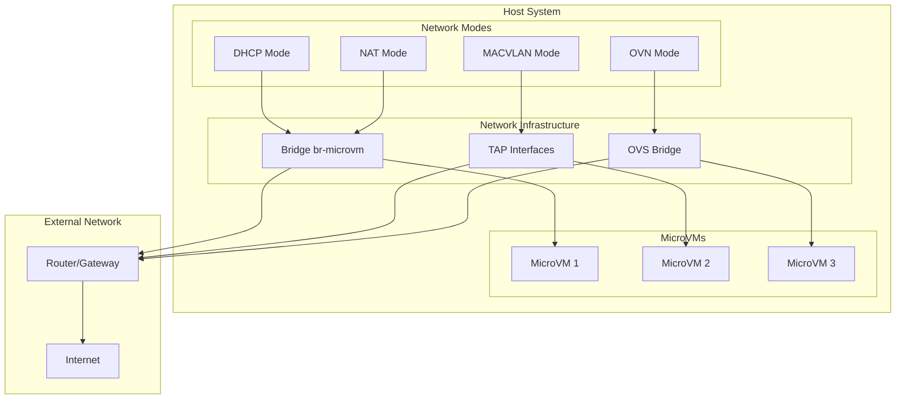

# MicroVM Service Networking Configuration Guide

## Overview

This guide provides comprehensive instructions for configuring different networking modes for MicroVMs in the MicroVM Service. The service supports four primary networking modes: DHCP, MACVLAN, NAT, and OVN (Open Virtual Network).

## Networking Architecture



## DHCP Mode Configuration

### Overview
DHCP mode assigns IP addresses to microVMs through an existing DHCP server on the network. This is ideal for production environments with centralized IP management.

### Prerequisites
- Existing DHCP server on the network
- Bridge interface configured on the host
- Sufficient IP addresses available in DHCP pool

### Host Configuration

#### 1. Create Bridge Interface
```bash
#!/bin/bash
# setup-dhcp-bridge.sh

# Create bridge interface
sudo ip link add name br-microvm type bridge
sudo ip link set br-microvm up

# Add physical interface to bridge (optional, for direct network access)
sudo ip link set eth0 master br-microvm

# Configure bridge to use DHCP
sudo dhclient br-microvm
```

#### 2. Configure Persistent Bridge
Create `/etc/netplan/01-microvm-bridge.yaml`:

```yaml
network:
  version: 2
  renderer: networkd
  ethernets:
    eth0:
      dhcp4: false
      dhcp6: false
  bridges:
    br-microvm:
      interfaces: [eth0]
      dhcp4: true
      dhcp6: false
      parameters:
        stp: false
        forward-delay: 0
```

Apply configuration:
```bash
sudo netplan apply
```

#### 3. Service Configuration
Update `/etc/microvm-service/config.json`:

```json
{
  "networking": {
    "default_mode": "dhcp",
    "dhcp": {
      "bridge_name": "br-microvm",
      "dns_servers": ["8.8.8.8", "8.8.4.4"],
      "domain": "microvm.local",
      "lease_time": "12h"
    }
  }
}
```

### MicroVM Configuration

#### API Request Example
```bash
curl -X POST http://localhost:8080/api/v1/microvms \
  -H "Authorization: Bearer $API_KEY" \
  -H "Content-Type: application/json" \
  -d '{
    "resource_specs": {
      "vcpus": 2,
      "memory_mb": 1024,
      "storage_mb": 5120
    },
    "network_config": {
      "assignment_method": "dhcp",
      "dns_servers": ["8.8.8.8", "8.8.4.4"]
    },
    "customer_id": "customer-123"
  }'
```

#### Firecracker Configuration Generated
```json
{
  "network-interfaces": [{
    "iface_id": "eth0",
    "guest_mac": "AA:FC:00:00:00:01",
    "host_dev_name": "tap-vm-123"
  }]
}
```

### Troubleshooting DHCP Mode

#### Common Issues
1. **No IP Address Assigned**
   ```bash
   # Check DHCP server logs
   sudo journalctl -u isc-dhcp-server -f
   
   # Monitor DHCP traffic
   sudo tcpdump -i br-microvm port 67 or port 68
   
   # Verify bridge configuration
   ip addr show br-microvm
   ```

2. **Network Connectivity Issues**
   ```bash
   # Check bridge forwarding
   cat /proc/sys/net/bridge/bridge-nf-call-iptables
   
   # Verify routing
   ip route show
   
   # Test connectivity from host
   ping -I br-microvm 8.8.8.8
   ```

## MACVLAN Mode Configuration

### Overview
MACVLAN mode creates virtual network interfaces that appear as separate physical interfaces on the network. Each microVM gets direct access to the physical network.

### Prerequisites
- Physical network interface available
- Network switch supporting multiple MAC addresses per port
- Available IP addresses on the network

### Host Configuration

#### 1. Enable MACVLAN Support
```bash
# Load macvlan module
sudo modprobe macvlan

# Make persistent
echo 'macvlan' | sudo tee -a /etc/modules
```

#### 2. Configure Physical Interface
```bash
#!/bin/bash
# setup-macvlan.sh

PHYSICAL_INTERFACE="eth0"
MACVLAN_INTERFACE="macvlan0"

# Create MACVLAN interface
sudo ip link add link $PHYSICAL_INTERFACE name $MACVLAN_INTERFACE type macvlan mode bridge

# Bring up interface
sudo ip link set $MACVLAN_INTERFACE up

# Configure IP (if needed for host access)
sudo ip addr add 192.168.1.100/24 dev $MACVLAN_INTERFACE
```

#### 3. Service Configuration
Update `/etc/microvm-service/config.json`:

```json
{
  "networking": {
    "default_mode": "macvlan",
    "macvlan": {
      "parent_interface": "eth0",
      "mode": "bridge",
      "ip_range": "192.168.1.200-192.168.1.250",
      "gateway": "192.168.1.1",
      "dns_servers": ["192.168.1.1", "8.8.8.8"]
    }
  }
}
```

### MicroVM Configuration

#### API Request Example
```bash
curl -X POST http://localhost:8080/api/v1/microvms \
  -H "Authorization: Bearer $API_KEY" \
  -H "Content-Type: application/json" \
  -d '{
    "resource_specs": {
      "vcpus": 1,
      "memory_mb": 512,
      "storage_mb": 2048
    },
    "network_config": {
      "assignment_method": "macvlan",
      "ip_address": "192.168.1.210",
      "gateway": "192.168.1.1",
      "dns_servers": ["192.168.1.1", "8.8.8.8"]
    },
    "customer_id": "customer-456"
  }'
```

### Advanced MACVLAN Configuration

#### Multiple VLANs Support
```bash
# Create VLAN interfaces
sudo ip link add link eth0 name eth0.100 type vlan id 100
sudo ip link add link eth0 name eth0.200 type vlan id 200

# Create MACVLAN on VLAN interfaces
sudo ip link add link eth0.100 name macvlan100 type macvlan mode bridge
sudo ip link add link eth0.200 name macvlan200 type macvlan mode bridge
```

Service configuration for VLANs:
```json
{
  "networking": {
    "macvlan": {
      "vlans": {
        "100": {
          "parent_interface": "eth0.100",
          "ip_range": "10.100.1.200-10.100.1.250",
          "gateway": "10.100.1.1"
        },
        "200": {
          "parent_interface": "eth0.200",
          "ip_range": "10.200.1.200-10.200.1.250",
          "gateway": "10.200.1.1"
        }
      }
    }
  }
}
```

## NAT Mode Configuration

### Overview
NAT mode creates a private network for microVMs with Network Address Translation to provide internet access. This is ideal for development and testing environments.

### Prerequisites
- Available private IP range
- iptables for NAT configuration
- IP forwarding enabled

### Host Configuration

#### 1. Create NAT Bridge
```bash
#!/bin/bash
# setup-nat-bridge.sh

BRIDGE_NAME="br-microvm"
BRIDGE_IP="192.168.100.1/24"
PRIVATE_RANGE="192.168.100.0/24"
PUBLIC_INTERFACE="eth0"

# Create bridge
sudo ip link add name $BRIDGE_NAME type bridge
sudo ip addr add $BRIDGE_IP dev $BRIDGE_NAME
sudo ip link set $BRIDGE_NAME up

# Enable IP forwarding
echo 'net.ipv4.ip_forward=1' | sudo tee -a /etc/sysctl.conf
sudo sysctl -p

# Configure NAT
sudo iptables -t nat -A POSTROUTING -s $PRIVATE_RANGE -o $PUBLIC_INTERFACE -j MASQUERADE
sudo iptables -A FORWARD -i $BRIDGE_NAME -o $PUBLIC_INTERFACE -j ACCEPT
sudo iptables -A FORWARD -i $PUBLIC_INTERFACE -o $BRIDGE_NAME -m state --state RELATED,ESTABLISHED -j ACCEPT

# Save iptables rules
sudo iptables-save | sudo tee /etc/iptables/rules.v4
```

#### 2. Configure DHCP for NAT Network
```bash
# Install dnsmasq
sudo apt-get install dnsmasq

# Configure dnsmasq for NAT network
sudo tee /etc/dnsmasq.d/microvm-nat.conf << EOF
interface=br-microvm
dhcp-range=192.168.100.10,192.168.100.200,12h
dhcp-option=3,192.168.100.1
dhcp-option=6,8.8.8.8,8.8.4.4
bind-interfaces
EOF

# Restart dnsmasq
sudo systemctl restart dnsmasq
sudo systemctl enable dnsmasq
```

#### 3. Service Configuration
Update `/etc/microvm-service/config.json`:

```json
{
  "networking": {
    "default_mode": "nat",
    "nat_bridge": {
      "name": "br-microvm",
      "subnet": "192.168.100.0/24",
      "gateway": "192.168.100.1",
      "dhcp_range": "192.168.100.10-192.168.100.200",
      "dns_servers": ["8.8.8.8", "8.8.4.4"]
    },
    "port_forwarding": {
      "enabled": true,
      "ssh_port_range": "2200-2299"
    }
  }
}
```

### Port Forwarding Configuration

#### Automatic SSH Port Forwarding
```bash
#!/bin/bash
# configure-port-forwarding.sh

MICROVM_IP="192.168.100.10"
SSH_PORT="2201"
BRIDGE_NAME="br-microvm"

# Forward SSH port
sudo iptables -t nat -A PREROUTING -p tcp --dport $SSH_PORT -j DNAT --to-destination $MICROVM_IP:22
sudo iptables -A FORWARD -p tcp -d $MICROVM_IP --dport 22 -j ACCEPT

# Save rules
sudo iptables-save | sudo tee /etc/iptables/rules.v4
```

#### Custom Port Forwarding
```json
{
  "network_config": {
    "assignment_method": "nat",
    "port_forwarding": [
      {
        "host_port": 8080,
        "guest_port": 80,
        "protocol": "tcp"
      },
      {
        "host_port": 8443,
        "guest_port": 443,
        "protocol": "tcp"
      }
    ]
  }
}
```

## OVN (Open Virtual Network) Configuration

### Overview
OVN provides advanced networking features including distributed routing, security groups, and load balancing. It's suitable for complex multi-tenant environments.

### Prerequisites
- Open vSwitch (OVS) installed
- OVN central components (northbound/southbound databases)
- OVN controller running on each host

### OVN Installation

#### 1. Install OVS and OVN
```bash
# Ubuntu/Debian
sudo apt-get install openvswitch-switch openvswitch-common
sudo apt-get install ovn-central ovn-host ovn-common

# CentOS/RHEL
sudo yum install openvswitch ovn-central ovn-host
```

#### 2. Configure OVN Central
```bash
# Initialize OVN databases
sudo ovn-ctl start_northd
sudo ovn-ctl start_ovsdb

# Create integration bridge
sudo ovs-vsctl add-br br-int
sudo ovs-vsctl set bridge br-int fail-mode=secure

# Start OVN controller
sudo ovn-ctl start_controller
```

#### 3. Create Logical Network
```bash
# Create logical switch
sudo ovn-nbctl ls-add microvm-network

# Create logical router
sudo ovn-nbctl lr-add microvm-router

# Connect switch to router
sudo ovn-nbctl lrp-add microvm-router microvm-router-port 02:ac:10:ff:01:01 192.168.100.1/24
sudo ovn-nbctl lsp-add microvm-network microvm-network-router-port
sudo ovn-nbctl lsp-set-type microvm-network-router-port router
sudo ovn-nbctl lsp-set-options microvm-network-router-port router-port=microvm-router-port

# Configure external connectivity
sudo ovn-nbctl lrp-add microvm-router outside 02:ac:10:ff:01:02 10.0.0.100/24
sudo ovn-nbctl lr-route-add microvm-router 0.0.0.0/0 10.0.0.1
```

### Service Configuration

#### Update Configuration File
```json
{
  "networking": {
    "default_mode": "ovn",
    "ovn": {
      "logical_switch": "microvm-network",
      "logical_router": "microvm-router",
      "subnet": "192.168.100.0/24",
      "gateway": "192.168.100.1",
      "dns_servers": ["8.8.8.8", "8.8.4.4"],
      "security_groups": {
        "default": {
          "ingress": [
            {"protocol": "tcp", "port": 22, "source": "0.0.0.0/0"},
            {"protocol": "icmp", "source": "0.0.0.0/0"}
          ],
          "egress": [
            {"protocol": "all", "destination": "0.0.0.0/0"}
          ]
        }
      }
    }
  }
}
```

### Advanced OVN Features

#### Security Groups
```bash
# Create security group
sudo ovn-nbctl acl-add microvm-network to-lport 1000 'outport == "vm-123" && ip4.src == 192.168.100.10' allow

# Allow SSH access
sudo ovn-nbctl acl-add microvm-network to-lport 1000 'outport == "vm-123" && tcp.dst == 22' allow

# Allow ICMP
sudo ovn-nbctl acl-add microvm-network to-lport 1000 'outport == "vm-123" && icmp' allow

# Default deny
sudo ovn-nbctl acl-add microvm-network to-lport 0 'outport == "vm-123"' drop
```

#### Load Balancing
```bash
# Create load balancer
sudo ovn-nbctl lb-add microvm-lb 192.168.100.100:80 192.168.100.10:80,192.168.100.11:80

# Associate with logical switch
sudo ovn-nbctl ls-lb-add microvm-network microvm-lb
```

## Network Performance Optimization

### Tuning Parameters

#### Host Network Tuning
```bash
# Increase network buffer sizes
echo 'net.core.rmem_max = 134217728' | sudo tee -a /etc/sysctl.conf
echo 'net.core.wmem_max = 134217728' | sudo tee -a /etc/sysctl.conf
echo 'net.ipv4.tcp_rmem = 4096 87380 134217728' | sudo tee -a /etc/sysctl.conf
echo 'net.ipv4.tcp_wmem = 4096 65536 134217728' | sudo tee -a /etc/sysctl.conf

# Optimize bridge forwarding
echo 'net.bridge.bridge-nf-call-iptables = 0' | sudo tee -a /etc/sysctl.conf
echo 'net.bridge.bridge-nf-call-ip6tables = 0' | sudo tee -a /etc/sysctl.conf

# Apply settings
sudo sysctl -p
```

#### MicroVM Network Optimization
```json
{
  "firecracker": {
    "network_optimization": {
      "tx_queue_size": 1024,
      "rx_queue_size": 1024,
      "enable_multiqueue": true,
      "queue_pairs": 2
    }
  }
}
```

### Monitoring Network Performance

#### Network Metrics Collection
```bash
#!/bin/bash
# network-metrics.sh

# Monitor interface statistics
watch -n 1 'cat /proc/net/dev | grep -E "(br-microvm|tap-)"'

# Monitor bridge forwarding
sudo bridge fdb show br br-microvm

# Monitor OVS flows (if using OVN)
sudo ovs-ofctl dump-flows br-int

# Network latency testing
ping -c 10 192.168.100.10
```

#### Performance Testing
```bash
#!/bin/bash
# network-performance-test.sh

MICROVM_IP="192.168.100.10"

# Bandwidth test with iperf3
iperf3 -c $MICROVM_IP -t 30 -P 4

# Latency test
ping -c 100 -i 0.1 $MICROVM_IP

# Connection test
nc -zv $MICROVM_IP 22
```

## Security Considerations

### Network Isolation

#### VLAN Isolation
```bash
# Create isolated VLANs for different customers
sudo ip link add link eth0 name eth0.100 type vlan id 100
sudo ip link add link eth0 name eth0.200 type vlan id 200

# Create separate bridges
sudo ip link add name br-customer1 type bridge
sudo ip link add name br-customer2 type bridge

# Assign VLANs to bridges
sudo ip link set eth0.100 master br-customer1
sudo ip link set eth0.200 master br-customer2
```

#### Firewall Rules
```bash
#!/bin/bash
# microvm-firewall.sh

# Block inter-microVM communication by default
sudo iptables -A FORWARD -i br-microvm -o br-microvm -j DROP

# Allow specific communication
sudo iptables -I FORWARD -i br-microvm -o br-microvm -s 192.168.100.10 -d 192.168.100.11 -j ACCEPT

# Rate limiting
sudo iptables -A FORWARD -i br-microvm -m limit --limit 100/sec --limit-burst 200 -j ACCEPT
```

### Access Control

#### MAC Address Management
```json
{
  "networking": {
    "mac_address_management": {
      "prefix": "AA:FC:00",
      "allocation_method": "sequential",
      "reserved_ranges": [
        "AA:FC:00:00:00:01-AA:FC:00:00:00:FF"
      ]
    }
  }
}
```

#### Network ACLs
```bash
# OVN ACL examples
sudo ovn-nbctl acl-add microvm-network to-lport 1000 'outport == "vm-123" && ip4.src == 192.168.100.10 && tcp.dst == 80' allow
sudo ovn-nbctl acl-add microvm-network from-lport 1000 'inport == "vm-123" && ip4.dst == 8.8.8.8 && udp.dst == 53' allow
```

## Troubleshooting Network Issues

### Common Network Problems

#### 1. No Network Connectivity
```bash
# Check interface status
ip link show
ip addr show

# Verify bridge configuration
brctl show
bridge link show

# Check routing
ip route show
```

#### 2. DHCP Issues
```bash
# Monitor DHCP traffic
sudo tcpdump -i br-microvm port 67 or port 68 -v

# Check dnsmasq logs
sudo journalctl -u dnsmasq -f

# Test DHCP manually
sudo dhclient -v tap-vm-123
```

#### 3. NAT Problems
```bash
# Check iptables rules
sudo iptables -t nat -L -n -v
sudo iptables -L FORWARD -n -v

# Verify IP forwarding
cat /proc/sys/net/ipv4/ip_forward

# Test NAT connectivity
sudo tcpdump -i eth0 host 192.168.100.10
```

#### 4. OVN Issues
```bash
# Check OVN status
sudo ovn-nbctl show
sudo ovn-sbctl show

# Verify logical flows
sudo ovn-sbctl lflow-list

# Check OVS flows
sudo ovs-ofctl dump-flows br-int
```

### Network Debugging Tools

#### Packet Capture
```bash
# Capture traffic on bridge
sudo tcpdump -i br-microvm -w /tmp/microvm-traffic.pcap

# Capture specific traffic
sudo tcpdump -i br-microvm host 192.168.100.10 and port 22

# Analyze with tshark
tshark -r /tmp/microvm-traffic.pcap -Y "ip.addr == 192.168.100.10"
```

#### Network Testing
```bash
#!/bin/bash
# network-test-suite.sh

MICROVM_IP="192.168.100.10"

echo "Testing network connectivity..."

# Ping test
if ping -c 3 $MICROVM_IP > /dev/null; then
    echo "✓ Ping successful"
else
    echo "✗ Ping failed"
fi

# SSH test
if nc -z $MICROVM_IP 22; then
    echo "✓ SSH port accessible"
else
    echo "✗ SSH port not accessible"
fi

# DNS test
if nslookup google.com $MICROVM_IP > /dev/null; then
    echo "✓ DNS resolution working"
else
    echo "✗ DNS resolution failed"
fi

# HTTP test
if curl -s --connect-timeout 5 http://$MICROVM_IP > /dev/null; then
    echo "✓ HTTP service accessible"
else
    echo "✗ HTTP service not accessible"
fi
```

## Best Practices

### Network Design
1. **Segmentation**: Use VLANs or separate networks for different customers
2. **Security**: Implement proper firewall rules and access controls
3. **Performance**: Optimize network parameters for your workload
4. **Monitoring**: Implement comprehensive network monitoring
5. **Documentation**: Maintain accurate network topology documentation

### Configuration Management
1. **Version Control**: Store network configurations in version control
2. **Automation**: Use scripts for consistent network setup
3. **Testing**: Test network configurations in staging environment
4. **Backup**: Maintain backups of network configurations

### Troubleshooting
1. **Systematic Approach**: Follow a structured troubleshooting methodology
2. **Documentation**: Document common issues and solutions
3. **Monitoring**: Use monitoring tools to identify issues proactively
4. **Testing**: Implement automated network testing

## Additional Resources

### Documentation
- [Open vSwitch Documentation](http://docs.openvswitch.org/)
- [OVN Documentation](http://www.ovn.org/support/)
- [Linux Bridge Documentation](https://wiki.linuxfoundation.org/networking/bridge)
- [iptables Tutorial](https://www.netfilter.org/documentation/HOWTO/packet-filtering-HOWTO.html)

### Tools
- [Wireshark](https://www.wireshark.org/) - Network protocol analyzer
- [iperf3](https://iperf.fr/) - Network performance testing
- [tcpdump](https://www.tcpdump.org/) - Packet capture utility
- [netstat](https://linux.die.net/man/8/netstat) - Network statistics

### Community Resources
- [Open vSwitch Mailing Lists](http://openvswitch.org/support/)
- [Linux Networking Documentation](https://www.kernel.org/doc/Documentation/networking/)
- [Network Configuration Examples](https://github.com/your-org/microvm-service/tree/main/examples/networking)