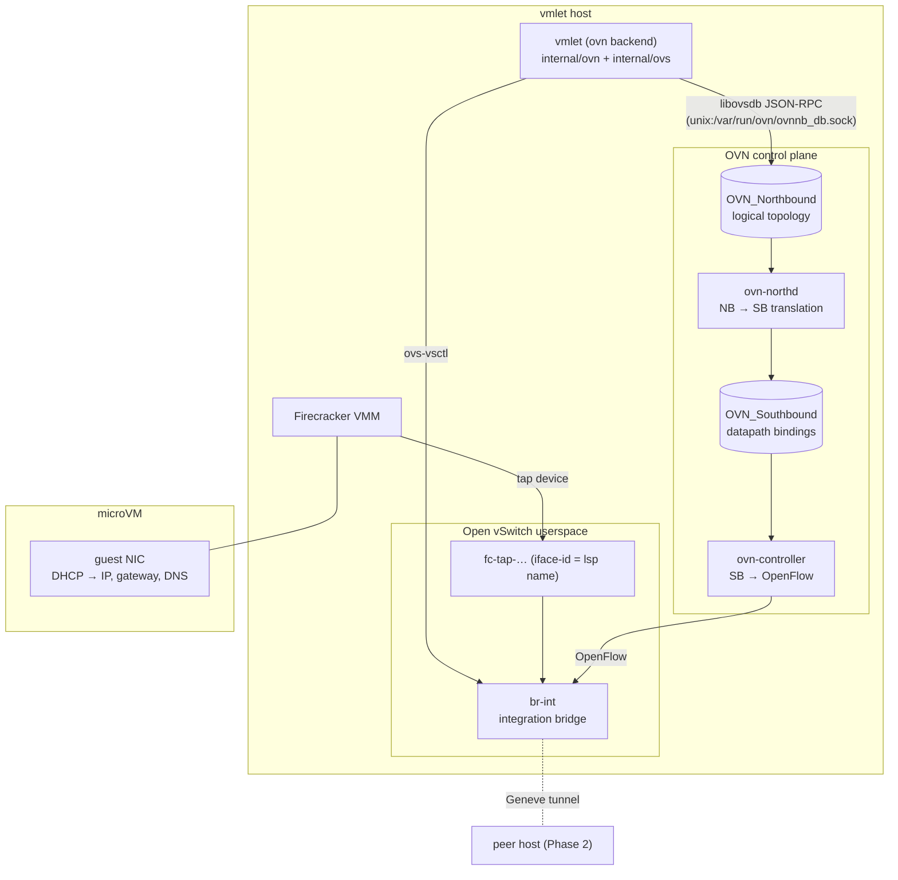

# OVN backend operator guide

This document covers running vmlet with **OVN** as the primary network
backend: how to stand up a host, what each moving part does, how to tune it,
and how to debug the failures operators actually hit.

The bridge backend remains fully supported and is still the default. See
[NETWORKING_CONFIGURATION_GUIDE.md](NETWORKING_CONFIGURATION_GUIDE.md) for the
bridge/dnsmasq path, and [ROADMAP.md](../ROADMAP.md) for how OVN fits into the
project's phases.

> **Status:** Phase 1 (`v0.2.0`). The OVN backend is complete for single-node
> use. Multi-node clustering (Phase 2) is not in place yet, so a VM lives on
> exactly one host.

---

## 1. Why OVN

With a Linux bridge every VM's networking is anchored to the host it boots on:
the bridge, the MACVLAN, the ebtables rules and the DHCP leases are all local
state. That makes three things impossible down the road — a network that
survives moving a VM, a cluster that shares one logical topology, and automatic
rebalancing.

OVN replaces that local plumbing with a **logical** topology stored in a
database. A VM gets a logical port; the port keeps its IP, MAC, security groups
and bandwidth limits wherever it is instantiated. Geneve tunnels between hosts
carry the traffic, so the same logical switch spans the whole cluster.

| Bridge backend | OVN backend |
|---|---|
| Linux bridge + TAP | OVS `br-int` + TAP, bound by `iface-id` |
| dnsmasq hosts files per VM | OVN `DHCP_Options` per subnet |
| ebtables anti-spoof rules | logical `port_security` |
| `tc` qdiscs for shaping | OVS QoS queues + ingress policing |
| iptables NAT for public IPs | logical router DNAT/SNAT |
| All state is host-local | Logical topology is portable |

---

## 2. Architecture



**Control plane vs data plane.** The two are separate, and keeping them
straight is the single most useful thing you can know when debugging:

- `internal/ovn` writes **desired logical state** into the Northbound DB
  (switches, ports, DHCP options, ACLs, NAT). It talks JSON-RPC, pure Go, no
  shell.
- `internal/ovs` writes **host-level plumbing** with `ovs-vsctl` (br-int, tap
  attachment, `iface-id`, QoS).
- `ovn-northd` is the translator: it reads NB and produces SB.
- `ovn-controller` reads SB and installs OpenFlow into `br-int`.

A symptom like "the VM has no IP" can therefore come from three different
places: the VM's port has no `dhcpv4_options` bound (NB), the tap is not on
`br-int` (OVS), or the controller is not running (SB → OpenFlow).

### What vmlet writes where

| vmlet package | Target | What it creates |
|---|---|---|
| `internal/ovn` | `OVN_Northbound` | `Logical_Switch`, `Logical_Switch_Port`, `Logical_Router`, `Logical_Router_Port`, `DHCP_Options`, `DNS`, `ACL`, `NAT` |
| `internal/ovs` | local OVS | `br-int`, tap ports with `external_ids:iface-id`, QoS queues, ingress policing |

---

## 3. Host prerequisites

### Kernel and hardware

- **KVM** enabled (`/dev/kvm` present; nested virtualisation if this host is
  itself a VM).
- A kernel with **Open vSwitch** and the `geneve` module. OVS ships in-tree, so
  any distribution kernel works; `modprobe openvswitch geneve` confirms.
- Root (or equivalent capabilities) — vmlet manages tap devices, OVS and
  Firecracker.

### Packages

| Distro family | Packages |
|---|---|
| Debian/Ubuntu | `openvswitch-switch`, `ovn-central`, `ovn-host` |
| RHEL/Fedora | `openvswitch`, `ovn-central`, `ovn-host` |

Install them, or let the setup script do it:

```bash
sudo ./scripts/setup-ovn-host.sh
```

The script is idempotent and can be re-run at any time. It installs the
packages, creates `br-int`, installs and enables the three systemd units, and
verifies the result. Flags:

| Flag | Effect |
|---|---|
| `--bridge NAME` | use a different integration bridge (default `br-int`) |
| `--dry-run` | print what would be done, change nothing |
| `--skip-packages` | assume OVS/OVN are already installed |

### What the script enables

```
ovsdb-server   →  ovn-northd  →  ovn-controller
```

Order matters: the NB DB must be up before northd translates it, and the
controller must be running before it installs OpenFlow. The units in
[`systemd/ovn/`](../systemd/ovn/) encode that ordering.

Verify the daemons:

```bash
systemctl status ovsdb-server ovn-northd ovn-controller
```

---

## 4. Configuration

### Choosing the backend

```bash
sudo MICROVM_NETWORK_BACKEND=ovn ./vmlet-http
```

| Value | Meaning |
|---|---|
| `bridge` | default; Linux bridge + dnsmasq, unchanged behaviour |
| `ovn` | OVN overlay backend |
| `noop` | no host networking at all — for tests and externally-managed setups |

The variable is read through the backend registry in
`internal/network/backend.go`, so an unrecognised value fails loudly and lists
the registered names.

### The OVN config block

The Northbound endpoint defaults to the conventional socket:

```bash
# unix:/var/run/ovn/ovnnb_db.sock  (default)
```

Override it for a remote or non-standard NB database:

```bash
MICROVM_OVN_NB_ENDPOINT=tcp:<host>:6641
```

```json
{
  "networking": {
    "default_mode": "ovn",
    "ovn_config": {
      "ovs_bridge": "br-int",
      "subnet_cidr": "10.0.0.0/24",
      "gateway_ip": "10.0.0.1",
      "dns_servers": ["8.8.8.8", "1.1.1.1"]
    }
  }
}
```

| Field | Meaning |
|---|---|
| `ovs_bridge` | the integration bridge taps attach to |
| `subnet_cidr` | the network's subnet; drives DHCP options |
| `gateway_ip` | the router port address, i.e. the guests' default gateway |
| `dns_servers` | handed out over DHCP (option 6) |

### Naming is derived, not configured

vmlet does not let you name logical objects. Names are derived from the network
name, because the reconcile loop must be able to tell "the row I want" from "the
row someone else left behind" without any extra state:

| Object | Name | Example (`customer-3`) |
|---|---|---|
| VM switch | `vm-<network>` | `vm-customer-3` |
| Gateway switch | `gw-<network>` | `gw-customer-3` |
| Logical router | `lr-<network>` | `lr-customer-3` |
| Logical router port | `lrp-<network>` | `lrp-customer-3` |

Every object also carries `external_ids`, which is how the reconciler finds its
own rows and prunes the rest:

- `vmlet-managed=true` — created by vmlet; safe to prune
- `vmlet-network=<name>` — which network it belongs to
- `vmlet-vm=<id>` — which VM a port or rule belongs to
- `vmlet-role=vm|gateway` — separates VM ports from gateway ports

**Never hand-edit anything tagged `vmlet-managed=true`**: the next reconcile
will undo it. Create your own objects instead.

### Anti-spoofing parity

The OVN backend honours the same switches as the ebtables backend, so existing
tuning keeps working:

| Variable | Default | Meaning |
|---|---|---|
| `MICROVM_ANTISPOOF_ENABLE` | enabled | `false` disables anti-spoofing entirely |
| `MICROVM_ANTISPOOF_IP_ENABLE` | disabled | `true` pins the VM's IP in `port_security` |
| `MICROVM_ANTISPOOF_STRICT` | strict | best-effort when `false` |

---

## 5. Verifying an installation

```bash
# 1. The integration bridge exists and the OVS daemon answers.
ovs-vsctl show
ovs-vsctl br-exists br-int

# 2. The Northbound DB is reachable.
ovn-nbctl show

# 3. The controller is running and owns br-int.
systemctl is-active ovn-controller
ovs-vsctl get open_vswitch . external_ids:system-id

# 4. End-to-end: run the OVN e2e script (dry run by default).
./scripts/ovn-e2e-test.sh
./scripts/ovn-e2e-test.sh --live
```

After a VM is running, the two checks that matter:

```bash
# The tap is on br-int, and it carries the logical port name.
ovs-vsctl list-ports br-int
ovs-vsctl get interface <tap> external_ids:iface-id

# The logical port exists, has addresses and is bound to DHCP.
ovn-nbctl lsp-get-addresses <lsp-name>
ovn-nbctl --columns=dhcpv4_options list Logical_Switch_Port <lsp-name>
```

---

## 6. Tuning

### MTU and Geneve

Geneve encapsulation adds overhead, so a tunnel MTU that is too large causes
path-MTU black holes: small requests succeed and large transfers stall after a
handshake. This is the most common single-host OVN problem.

```bash
# The physical NIC's MTU.
ip link show <uplink>

# The tunnel MTU ovn-controller actually uses.
ovs-vsctl get interface <geneve> mtu
```

| Situation | Action |
|---|---|
| Standard 1500 MTU uplink | leave Geneve at 1445 (the safe default); no change needed |
| Jumbo frames (9000) | you can raise Geneve; not required to |

A guest that inherits a 1500 MTU over a 1445 tunnel works because fragmentation
and PMTU discovery handle it. If guests see curiously slow large transfers,
first check that the Geneve MTU is not *above* the physical MTU.

### Bandwidth limits

Limits are enforced with OVS QoS queues (egress) and interface ingress
policing (`ingress_policing_rate` / `ingress_policing_burst`), tuned to match
the `tc` implementation's behaviour. Rates are quoted as `100mbit` or `1gbit`;
burst is chosen from the rate band (32k → 384k).

```bash
ovs-vsctl get port <tap> qos
ovs-vsctl get interface <tap> ingress_policing_rate
```

Leaving the QoS row attached after removing a limit is a common mistake. vmlet
detaches it (`clear port <tap> qos`) and zeroes the policing rate whenever a
limit is cleared, so limits never linger.

### Ballooning and migration

Smart ballooning and live migration work unchanged behind the OVN backend — a
VM keeps its logical port and therefore its IP when it moves, which is the whole
point of the overlay. See [VM_MIGRATION_GUIDE.md](VM_MIGRATION_GUIDE.md).

---

## 7. Troubleshooting

Start every investigation the same way: **which layer?** Control plane, OVS
plumbing, controller, or guest.

### The layer-by-layer checks

```bash
# Layer 1: does the NB database hold what you expect?
ovn-nbctl show
ovn-nbctl ls-list
ovn-nbctl lsp-list <switch>
ovn-nbctl lr-list

# Layer 2: is the tap on the bridge with the right iface-id?
ovs-vsctl list-ports br-int
ovs-vsctl --columns=name,external_ids,ofport list interface <tap>

# Layer 3: is the controller running and converting NB into OpenFlow?
ovs-ofctl show br-int
ovs-ofctl dump-flows br-int | head -50

# Layer 4: inside the guest
ip addr && ip route && cat /etc/resolv.conf
```

### Symptom table

| Symptom | Likely layer | Command |
|---|---|---|
| VM boots but gets no IP | NB — no DHCP binding | `ovn-nbctl --columns=dhcpv4_options list Logical_Switch_Port <lsp>` |
| No IP, DHCP row exists | Controller | `systemctl status ovn-controller`; `ovs-appctl -t ovn-controller version` |
| VM has an IP but no gateway reachable | Router/NAT | `ovn-nbctl lr-list`; check `lrp-<network>` and its networks |
| VM cannot reach the internet | SNAT missing | `ovn-nbctl lr-nat-list <router>` |
| Floating IP does not answer | DNAT or ARP | `ovn-nbctl lr-nat-list <router>`; confirm the `mac` column |
| VM is unreachable entirely | OVS plumbing | `ovs-vsctl list-ports br-int`; `ovs-vsctl get interface <tap> ofport` (must not be `-1`) |
| Large transfers stall | MTU/Geneve | §6 above |
| Spoofed traffic not dropped | Port security | `ovs-vsctl --columns=port_security list interface <tap>` |
| Rules vanish after a while | Someone else reconciled | check `external_ids:vmlet-managed`, and see §4 |

### Tracing packets: `ovn-trace`

`ovn-trace` is the single most useful tool here: it simulates a packet through
the logical pipeline and prints which pipeline stage accepted or dropped it.

```bash
# "VM 10.0.0.10 pings the internet"
ovn-trace --ct new \
  'inport == "<lsp-name>" && ip4.src == 10.0.0.10 && icmp4' \
  'ip4.dst == 8.8.8.8 && icmp4'

# "someone opens a TCP connection to the VM"
ovn-trace --ct new \
  'inport == "<lrp-name>" && ip4.dst == 10.0.0.10 && tcp.dst == 22' \
  'ip4.src == 198.51.100.5 && tcp.src == 40000'
```

The output walks the pipeline in order (`from-l0` → `to-l1` → ...), so a
`drop` tells you exactly which logical rule rejected the packet.

### Inspecting flows: `ovs-ofctl`

```bash
# Physical view of the bridge: ports and their OpenFlow numbers.
ovs-ofctl show br-int

# The controller's OpenFlow — every logical rule becomes one of these.
ovs-ofctl dump-flows br-int
ovs-ofctl dump-flows br-int table=0

# A packet entering br-int is matched against these tables.
ovs-ofctl dump-table-stats br-int
```

An `ofport` of `-1` for an interface means the controller has not claimed it —
usually because `iface-id` is missing or mistyped.

### Health and logs

```bash
# Daemon health (the local equivalent of the DB's status()).
ovs-appctl -t ovsdb-server ovsdb-server/list-dbs
ovs-appctl -t ovn-controller version

# Firecracker/vmlet logs: structured lines tagged by subsystem.
```

### Restarting a node's control plane

```bash
sudo systemctl restart ovsdb-server ovn-northd ovn-controller
ovn-nbctl show
```

Because vmlet's reconcile loop derives everything from the database's *current*
state and the VM's desired state, a restart is safe — the next pass converges
the cluster back to what it should be. Nothing in Northbound is authoritative
except what vmlet last wrote.

---

## 8. Roadmap position

OVN exists first in this project precisely because a VM's network can then
survive a move. The next phases build directly on this document:

- **Phase 2 (`v0.3.0`)** — multi-node clustering: centralised NB/SB, Geneve
  tunnels everywhere, and a VM that keeps its IP when it live-migrates to
  another host.
- **Phase 3 (`v0.4.0`)** — automatic live migration, using the reconciliation
  described here as its safety net.

The Geneve hints above are here for that reason: once a second host joins the
same NB database, the tunnel path between the two `br-int`s becomes the thing to
look at first when connectivity breaks.